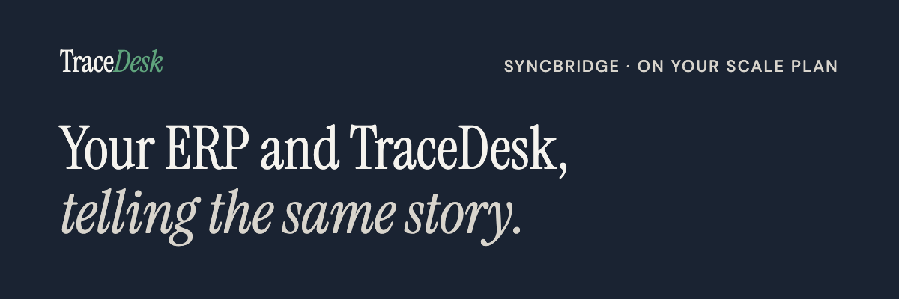

# Email 1 of 3: Scale customers who haven't connected SyncBridge

**Track:** Scale customers, SyncBridge not yet connected
**Audience:** Economic buyer (COO, VP Operations, Director of Procurement), with the IT lead as a likely forward
**Sender:** [CSM NAME], the account's dedicated CSM

## Subject line options

1. Two systems, two stories
2. SyncBridge is already on your Scale plan
3. New vendors in [ERP], tracked in TraceDesk automatically

**Preview text:** Most teams are live in under 3 hours, with minimal IT support.

**Header image:** [graphics/syncbridge-adoption-email-1-header.png](graphics/syncbridge-adoption-email-1-header.png), 1200×400, displayed at 600×200
**Alt text:** Your ERP and TraceDesk, telling the same story. SyncBridge is on your Scale plan.

---

Hi [FIRST NAME],

If your team adds new vendors in [ERP] and then again in TraceDesk, you're running two systems that tell two stories. Every manual import is a chance for a vendor to slip through before anyone checks their certificates.

SyncBridge closes that gap, and it's already on your Scale plan. When you connect it:

- **New vendors added in [ERP] appear in TraceDesk automatically.** There's no manual import step.
- **Compliance status writes back to your ERP vendor records.** Finance can see an expiring or lapsed certificate without a separate login.
- **Your ERP stays the source of truth.** Updates appear within 15–20 minutes.

> "Three carriers fell through the manual import gap in four months. That was three compliance exposures I didn't know I had. That gap is gone now."
> Nathan Osei, VP Operations, BlueLine Transport

**It's not an IT project.** No code. 41 customers have connected SyncBridge since May. Setup averages 2 hours 25 minutes, with a median of 25 minutes of IT time, usually to confirm permissions.

**[Connect SyncBridge]** [LINK]

If you'd rather have help, reply to this email and I'll walk you and your IT lead through it. If you run Dynamics 365, I can send a permission checklist ahead of time so your IT lead knows what to expect.

[CSM NAME]
Customer Success Manager, TraceDesk

P.S. Want to see it before you connect? We're running a live SyncBridge walkthrough on November 17 at 1pm Eastern, with time for your IT lead's questions. **[Save your seat]** [WEBINAR LINK]
