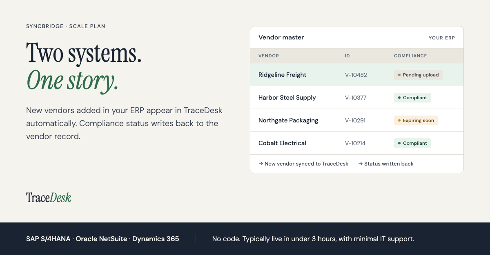

# LinkedIn post 1 of 4: The manual import gap

**Channel:** TraceDesk company page (public)
**Audience:** COOs, VPs of Operations, procurement leaders and IT leads at companies running an ERP, including current TraceDesk customers
**Angle:** Roster sync first, writeback second, "not an IT project" third
**Image:** [graphics/syncbridge-adoption-linkedin-post-1.png](graphics/syncbridge-adoption-linkedin-post-1.png), 1200×627
**Alt text:** Two systems. One story. An ERP vendor list showing TraceDesk compliance status for each vendor, including a newly synced vendor pending upload. SyncBridge works with SAP S/4HANA, Oracle NetSuite and Dynamics 365.

---

"Three carriers fell through the manual import gap in four months. That was three compliance exposures I didn't know I had. That gap is gone now."
Nathan Osei, VP Operations, BlueLine Transport

Most procurement teams keep two vendor lists: one in the ERP and one for compliance. Two systems, two stories. Every new vendor needs a manual step, and every manual step is a chance for a vendor with lapsed certificates to slip through.

SyncBridge connects TraceDesk to SAP S/4HANA, Oracle NetSuite and Microsoft Dynamics 365.

- New vendors added in your ERP appear in TraceDesk automatically.
- Compliance status writes back to your ERP vendor records, so finance sees it in the vendor record without a separate login.
- Your ERP stays the source of truth. Updates appear within 15–20 minutes.

It's not an IT project. No code. Customers are typically live in under 3 hours with minimal IT support.

SyncBridge is part of the TraceDesk Scale plan. Already on Scale? Your CSM can help you connect it. On Professional? You can upgrade at any time, prorated.

[LINK]

#Procurement #VendorCompliance #ERP
