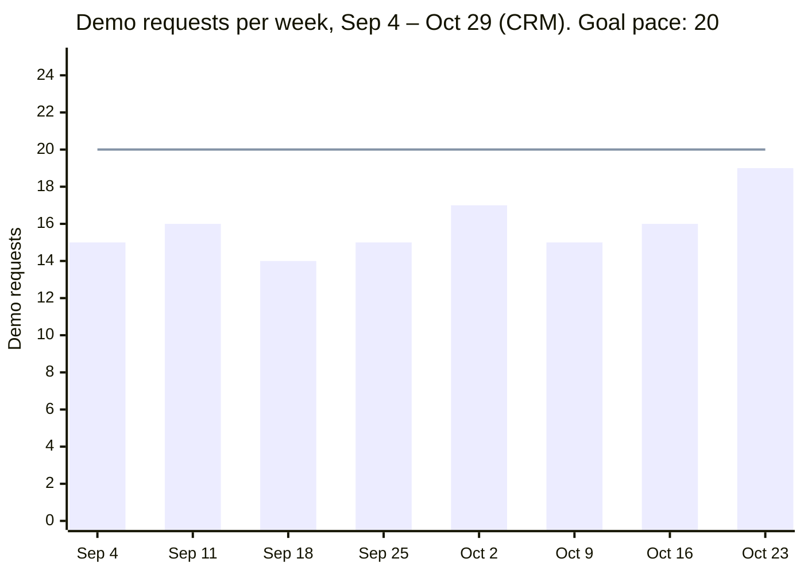

# Weekly marketing summary: Oct 23 – 29, 2026

Compared with Oct 16 – 22. Weeks run Friday to Thursday. Prepared November 2, 2026 for the marketing lead. **Internal.**

Full report with charts: [`2026-11-02-weekly-report.html`](2026-11-02-weekly-report.html) (download and open in a browser). Method and next week's upload checklist: [`2026-11-02-data-notes.md`](2026-11-02-data-notes.md).

## This week at a glance

| Metric | This week | Last week | Change |
|---|---:|---:|---:|
| Website sessions | 1,389 | 1,226 | +13.3% |
| New contacts | 29 | 24 | +20.8% |
| New MQLs | 9 | 10 | −10.0% |
| Pipeline created | $23,016 (2 deals) | $19,176 (2 deals) | +20.0% |
| Deals won | 1 ($11,988) | 0 | new |
| Ad spend (Google + LinkedIn) | $1,480 | $1,530 | −3.3% |

## Goals scorecard

| Goal | This week | Target | Status | Note |
|---|---:|---:|---|---|
| Website visitors | 1,165 users | 1,350 a week | Watch | Above the 1,110 baseline pace. Last week 1,034. |
| Demo requests | 19 | 20 a week | Watch | Best week since Sep 4. October to date: 72. |
| Visitor-to-demo rate | 1.63% | 1.8% | Watch | Last week 1.55%. |
| Google Ads cost per demo | $244 | $225 or less | Watch | Two weeks combined: $248.50 (Off track). Small sample. |
| LinkedIn cost per demo | $374 | $340 or less | Watch | Two weeks combined: $506.33 (Off track). Small sample. |

## What changed

1. **Website visits up 13%.** 1,389 sessions, up from 1,226. Organic Search added 110 of the 163 extra sessions.
2. **Demo requests: best week since Sep 4.** 19, one short of the 20 a week the goal needs.
3. **First won deal since Oct 1.** Alder Ridge Foods, $11,988, Professional plan, from Google search. 15 open deals worth $162,540.

## Needs attention

- **LinkedIn costs $506 per demo** over two weeks, against a $340 goal. The Vendor audit ad spent $264 with no demo requests.
- **Newsletter clicks are down four sends in a row.** Click rate fell from 1.95% to 1.20% while the list grew.
- **Two deals worth $21,576 have gone quiet.** Lumen Logistics (trial active, 18 days, Priya Nair) and Hartwell Facilities Services (demo completed, 16 days, Maya Chen).
- **Fewer new contacts.** 32.5 a week in September, 27.5 in October. Demo requests held at 14–19, so the drop is in people who never ask for a demo.

## What's working

- **Organic Search brings the most demos:** 8 of 19 this week (last week 6), with sessions up 25%.
- **Referrals convert best:** 4.2% of referral visits led to a demo request or trial, and referrals brought 2 of the 6 deals won since August.
- **Google's "Vendor compliance software" ads beat the cost goal:** $220 per demo over two weeks (3 demos), cheaper than the $225 goal.

## Try this week

1. **Restart the two quiet deals.** Priya Nair checks in on the Lumen Logistics trial; Maya Chen follows up with Hartwell Facilities Services.
2. **Test one change in the next newsletter**, for example one main link to the manufacturing compliance checklist. Compare click rate with 1.20%.
3. **Pause the LinkedIn Vendor audit ad for a week** and move its budget to "Vendor compliance software" search. Small samples, so check again next Monday.
